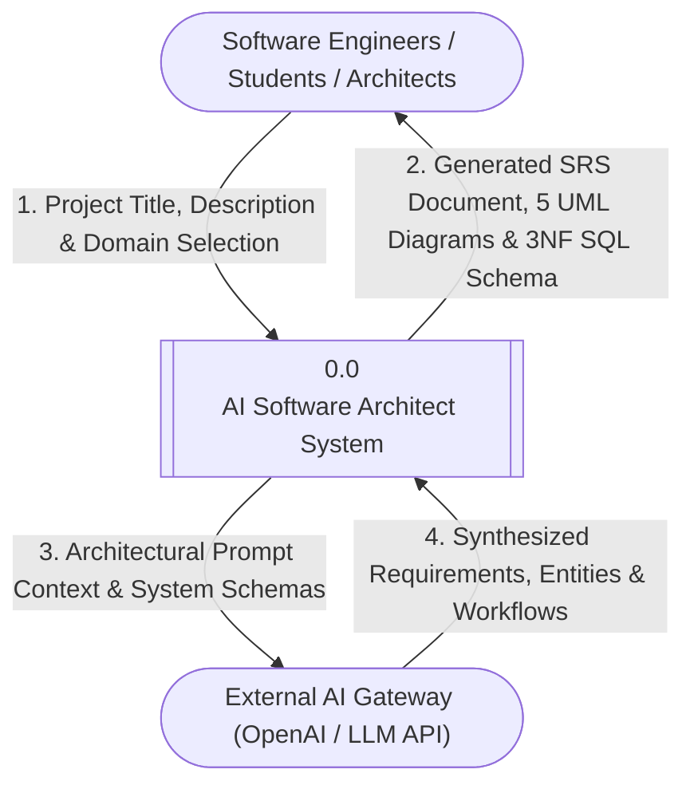
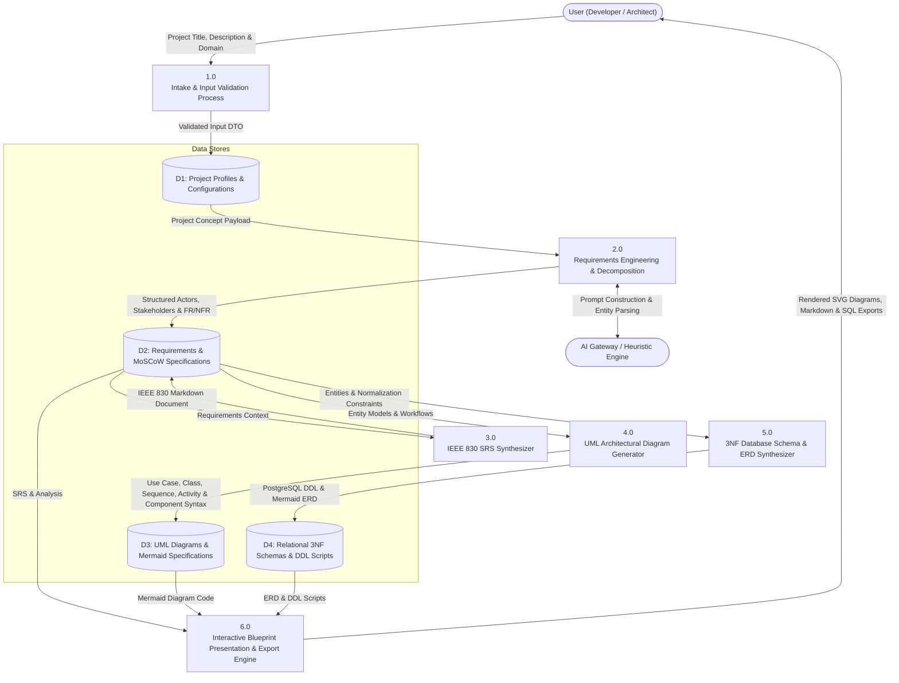
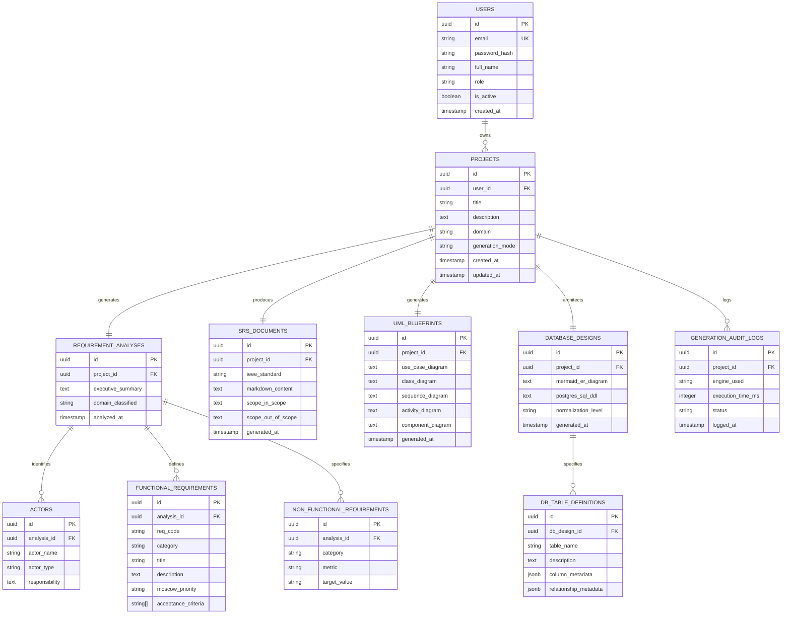
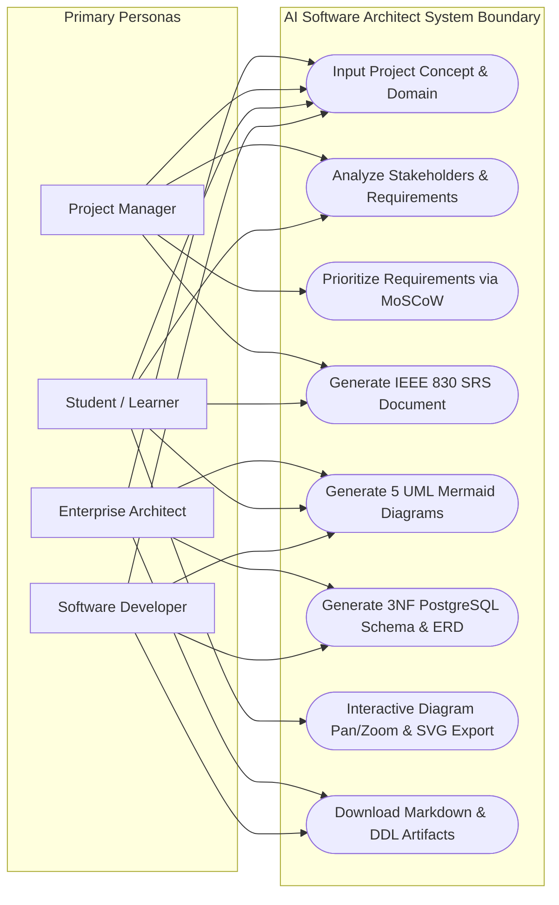
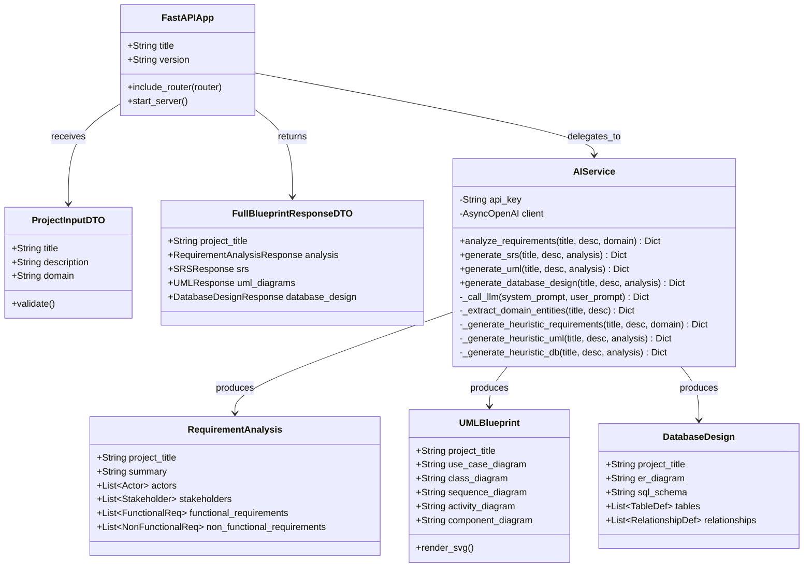
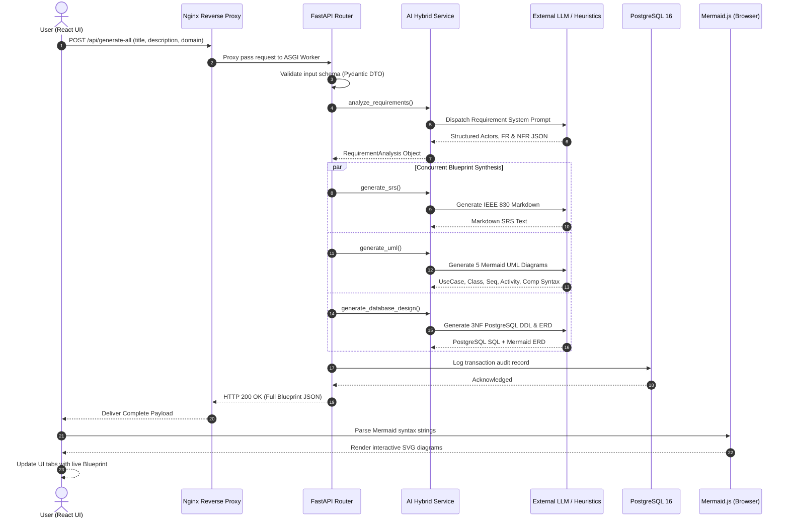
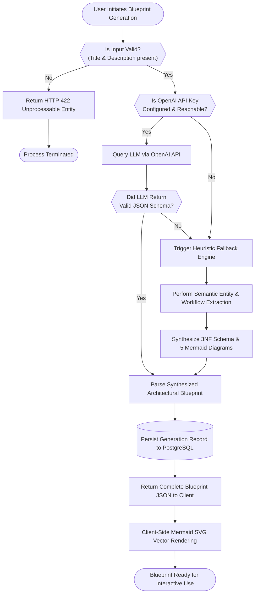
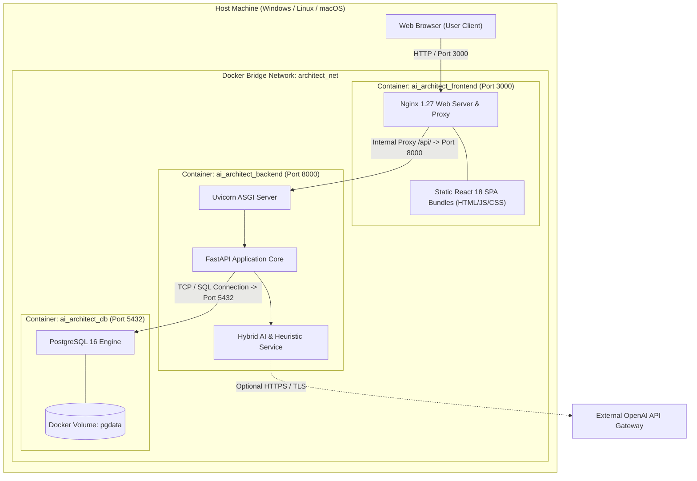

# Comprehensive Architectural Diagrams for AI Software Architect

This document contains the complete set of **Data Flow Diagrams (DFD)**, **Entity-Relationship Diagrams (ERD)**, and **UML Diagrams** modeled specifically for the **AI Software Architect** application.

---

# B. Data Flow Diagrams (DFD)

### B.1 Level 0 DFD — Context Diagram
The Level 0 Context Diagram depicts the boundaries of the AI Software Architect system, the external entities (Developers, Architects, Students, External AI Gateway), and the primary data flows into and out of the system.

---

### B.2 Level 1 DFD — Detailed Process Decomposition
The Level 1 DFD breaks down the system into its 5 primary subprocesses, illustrating how project data flows through analysis, document synthesis, diagram modeling, database design, and data storage.

---

# C. Entity-Relationship Diagram (ERD)

The ERD models the database structure of the **AI Software Architect** platform, tracking users, submitted project specifications, generated requirements, UML diagrams, database designs, and export audit trails.

---

# D. UML Diagrams

### D.1 UML Use Case Diagram
Illustrates how end users (Software Developers, Students, Project Managers, Software Architects) interact with the application capabilities.

---

### D.2 UML Class Diagram (Application OOP Architecture)
Depicts the object-oriented design and structural composition of the backend engines, schemas, and services.

---

### D.3 UML Sequence Diagram (System Execution Workflow)
Models the chronological message flow across tiers during blueprint generation.

---

### D.4 UML Activity Diagram (Process Control Flow)
Illustrates the internal control flow, decision branches, and fallback mechanisms when processing requests.

---

### D.5 UML Component / Deployment Diagram
Shows the physical and logical container deployment topology across the Docker Compose bridge network.

