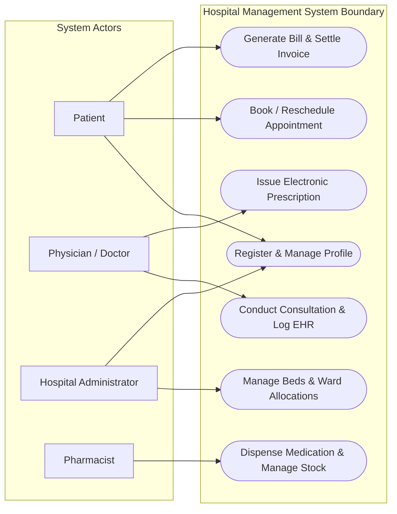
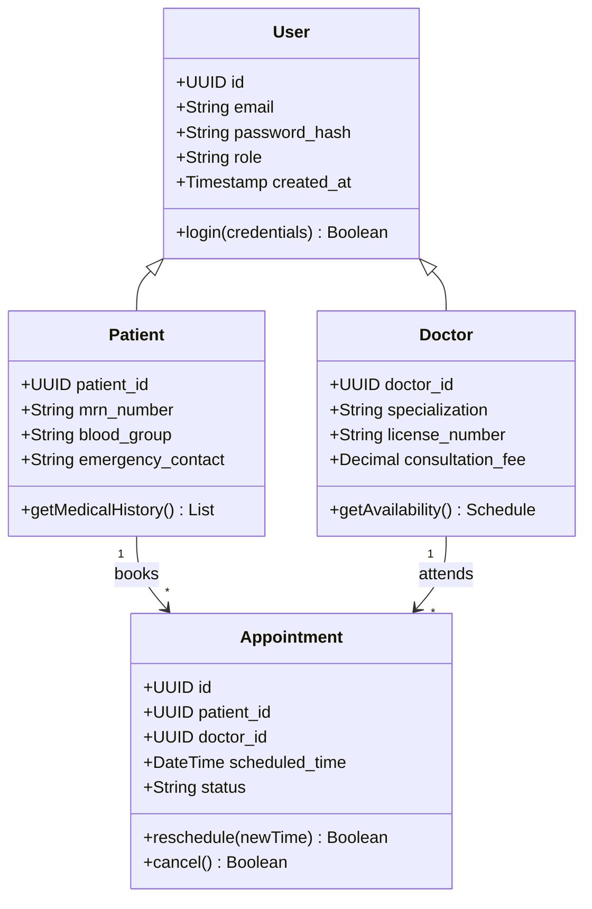

# Sample Architecture Blueprint: Hospital Management System

## 1. System Overview
- **Project Title:** Hospital Management System
- **Domain:** Healthcare & Clinical Informatics
- **Target Scale:** Enterprise Scale
- **Summary:** An enterprise-grade Hospital Management System designed to streamline clinical workflows, patient EHR management, doctor appointment scheduling, pharmacy inventory, and billing automation with strict HIPAA compliance.

---

## 2. Actors & Stakeholders
### System Actors
1. **Patient (Primary):** Registers, books outpatient appointments, views medical history, pays invoices.
2. **Physician / Doctor (Primary):** Conducts consultations, issues electronic prescriptions (e-Rx), and logs clinical diagnoses.
3. **Hospital Administrator (Secondary):** Manages doctor schedules, ward/bed occupancy, audit logs, and system roles.
4. **Pharmacist (Secondary):** Dispenses prescribed medications, tracks batch inventory, and flags low stock.
5. **Billing Officer (Secondary):** Generates itemized invoices, processes insurance claims, and issues receipts.

### Stakeholders
1. **Chief Medical Officer (CMO):** Clinical efficiency, patient safety, and error reduction.
2. **Hospital Board & CFO:** Revenue cycle management and asset utilization.
3. **Compliance & Security Auditors:** HIPAA, GDPR, and NABH regulatory compliance.

---

## 3. Functional Requirements
- **FR-01: Patient Registration and Electronic Health Record (EHR)** (Priority: Must Have)
- **FR-02: Real-time Doctor Slot Booking & Rescheduling** (Priority: Must Have)
- **FR-03: Clinical Notes and E-Prescription (e-Rx)** (Priority: Must Have)
- **FR-04: Pharmacy Dispensation and Stock Replenishment** (Priority: Should Have)
- **FR-05: Multi-tier Invoicing and Insurance Claim Processing** (Priority: Must Have)

---

## 4. Mermaid UML Diagrams

### 4.1 Use Case Diagram


### 4.2 Class Diagram


---

## 5. PostgreSQL Relational Schema

```sql
CREATE EXTENSION IF NOT EXISTS "uuid-ossp";

CREATE TABLE users (
    id UUID PRIMARY KEY DEFAULT uuid_generate_v4(),
    email VARCHAR(255) UNIQUE NOT NULL,
    password_hash VARCHAR(255) NOT NULL,
    role VARCHAR(50) NOT NULL CHECK (role IN ('ADMIN', 'DOCTOR', 'PATIENT', 'PHARMACIST', 'BILLING')),
    is_active BOOLEAN NOT NULL DEFAULT TRUE,
    created_at TIMESTAMP WITH TIME ZONE DEFAULT CURRENT_TIMESTAMP
);

CREATE TABLE patients (
    id UUID PRIMARY KEY DEFAULT uuid_generate_v4(),
    user_id UUID UNIQUE REFERENCES users(id) ON DELETE CASCADE,
    mrn_number VARCHAR(64) UNIQUE NOT NULL,
    full_name VARCHAR(255) NOT NULL,
    date_of_birth DATE NOT NULL,
    contact_phone VARCHAR(50) NOT NULL
);

CREATE TABLE doctors (
    id UUID PRIMARY KEY DEFAULT uuid_generate_v4(),
    user_id UUID UNIQUE REFERENCES users(id) ON DELETE CASCADE,
    full_name VARCHAR(255) NOT NULL,
    specialization VARCHAR(150) NOT NULL,
    license_number VARCHAR(100) UNIQUE NOT NULL,
    consultation_fee NUMERIC(10, 2) NOT NULL DEFAULT 0.00
);

CREATE TABLE appointments (
    id UUID PRIMARY KEY DEFAULT uuid_generate_v4(),
    patient_id UUID NOT NULL REFERENCES patients(id) ON DELETE RESTRICT,
    doctor_id UUID NOT NULL REFERENCES doctors(id) ON DELETE RESTRICT,
    scheduled_start TIMESTAMP WITH TIME ZONE NOT NULL,
    scheduled_end TIMESTAMP WITH TIME ZONE NOT NULL,
    status VARCHAR(30) NOT NULL DEFAULT 'SCHEDULED'
);
```
