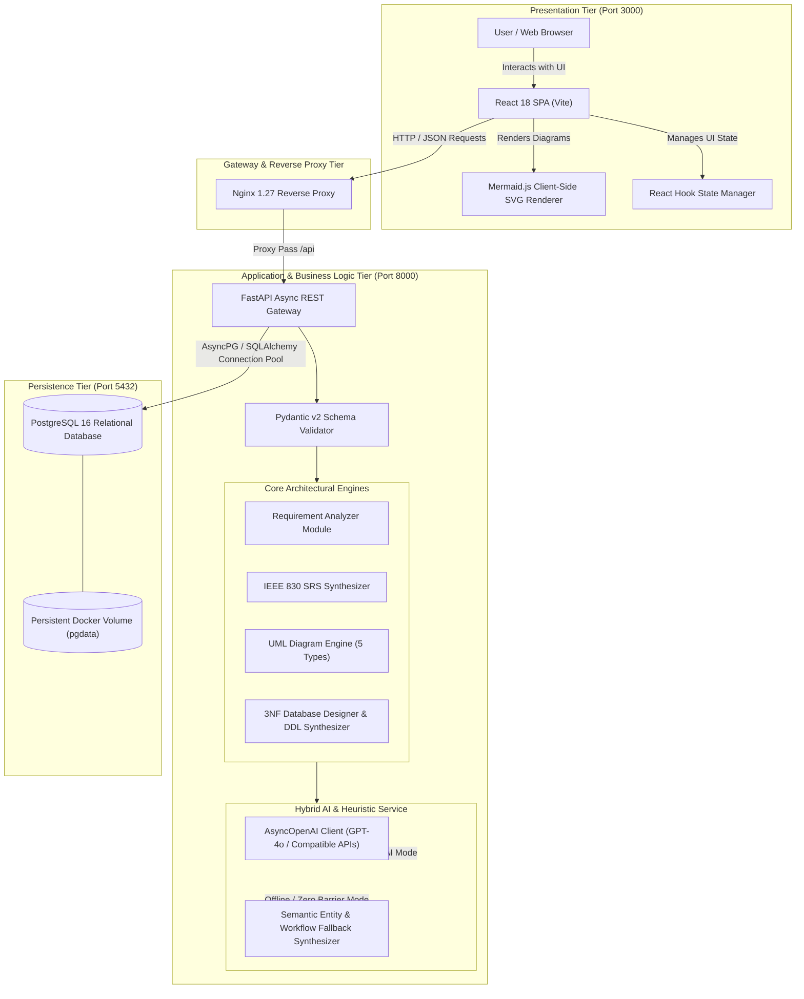
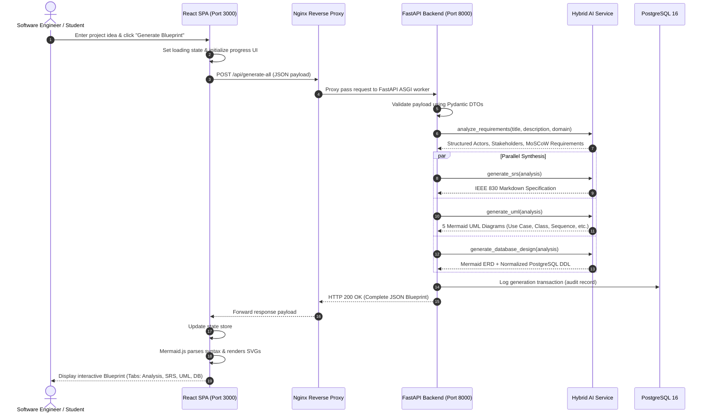

# System Architecture & Technical Design Document

**Project**: AI Software Architect  
**Version**: 1.0.0  
**Standard Compliance**: IEEE Std 1016-2009 (Systems and Software Engineering — Life Cycle Processes — Requirements Engineering)

---

## 1. Executive Summary & Architectural Vision

**AI Software Architect** automates the labor-intensive initial planning phase of software engineering. Traditional development requires senior architects to spend days drafting Software Requirement Specifications (SRS), UML diagrams, and database schemas before writing a single line of code.

This application implements a **3-Tier Cloud-Native Architecture** that accepts high-level natural language project descriptions and autonomously synthesizes:
1. **Requirements Engineering Breakdown**: Actors, stakeholders, and MoSCoW-prioritized functional/non-functional requirements.
2. **IEEE 830-1998 Compliant SRS Specification**: Ready for human engineering teams.
3. **Five Unified Modeling Language (UML) Diagrams**: Rendered live via Mermaid.js (Use Case, Class, Sequence, Activity, and Component diagrams).
4. **Normalized PostgreSQL Relational Database Schema**: 3NF/BCNF table definitions, UUID primary keys, foreign key constraints, indexes, and Mermaid ER diagram.

---

## 2. High-Level System Architecture Diagram

---

## 3. Tier-by-Tier Component Design

### 3.1 Presentation Tier (Frontend)
- **Technology Stack**: React 18, Vite 5.3, Tailwind CSS, Lucide Icons, Mermaid.js 10.9.
- **Architectural Responsibilities**:
  - **Single Page Application (SPA)**: Asynchronous client-side routing and tab switching without full-page reloads.
  - **Dynamic Diagram Visualizer (`MermaidViewer.jsx`)**: Renders declarative Mermaid text strings directly into interactive Scalable Vector Graphics (SVG) on the client side.
  - **Interactive Viewport Controls**: Provides Zoom In, Zoom Out, Reset Pan, Raw Code Viewer, and 1-Click SVG/Markdown Download.
  - **Instant Preset Injection**: Offers instant architectural templates (Hospital Management, LMS, E-Commerce, Drone Delivery) to accelerate exploration.

### 3.2 Application / Business Logic Tier (Backend)
- **Technology Stack**: FastAPI 0.111, Python 3.11, Uvicorn, Pydantic v2, HTTPX.
- **Architectural Responsibilities**:
  - **Asynchronous Pipeline**: Built on ASGI (`uvicorn`) for high concurrency and low latency.
  - **Contract-First Validation (`app/models/schemas.py`)**: All inputs and outputs are validated strictly by Pydantic models.
  - **Modular REST Endpoints**:
    - `POST /api/analyze`: Requirements decomposition and stakeholder extraction.
    - `POST /api/srs`: Formal IEEE 830-1998 document synthesis.
    - `POST /api/uml`: 5-type Mermaid UML generation.
    - `POST /api/database`: 3NF schema, ERD, and SQL script generation.
    - `POST /api/generate-all`: Unified aggregation endpoint returning complete blueprints in a single atomic call.
    - `GET /api/health`: Diagnostic health check for monitoring probes.

### 3.3 AI Hybrid Integration Gateway (`app/services/ai_service.py`)
- **Dual-Mode Architectural Pattern**:
  - **Mode 1 (LLM-Powered)**: When `OPENAI_API_KEY` is provided, requests are structured into optimized architectural system prompts and processed via OpenAI's GPT models.
  - **Mode 2 (Autonomous Semantic Heuristic Engine)**: When no API key is configured (or when external APIs time out), the engine automatically switches to a local semantic parser. It extracts domain nouns, actors, lifecycle states, and relational constraints directly from the user's text, guaranteeing 100% offline functionality with zero external dependencies.

### 3.4 Data & Persistence Tier (Database)
- **Technology Stack**: PostgreSQL 16 Alpine with `uuid-ossp` extension.
- **Architectural Responsibilities**:
  - **Relational Integrity**: Enforces Third Normal Form (3NF) and Boyce-Codd Normal Form (BCNF).
  - **Referential Actions**: Configured with `ON DELETE CASCADE` and `ON DELETE RESTRICT` to protect data consistency.
  - **Performance Optimization**: B-Tree indexes on foreign keys, email lookups, and lifecycle status fields.

---

## 4. End-to-End Execution Sequence Flow

The following sequence diagram illustrates the lifecycle of a blueprint generation request:

---

## 5. Non-Functional Architecture & Quality Attributes

| Quality Attribute | Architectural Tactic & Implementation |
|---|---|
| **Resilience & Fault Tolerance** | Dual-mode hybrid AI engine ensures zero downtime. If the OpenAI API is unreachable or rate-limited, the system falls back to semantic heuristic generation seamlessly. |
| **Reproducibility & Portability** | Full containerization via Docker and Docker Compose ensures identical execution across Windows, Linux, and macOS. |
| **Performance & Latency** | Non-blocking asynchronous I/O (`asyncio`, `uvicorn`), client-side diagram rendering (relieving backend CPU), and lightweight Alpine container images. |
| **Security & Isolation** | Container network isolation (`architect_net`), strict CORS middleware configuration, and automated input validation via Pydantic to prevent injection attacks. |
| **Extensibility** | Decoupled modular service boundaries allow easy addition of new diagram types (e.g., State Machine, Deployment) or new database dialects (e.g., MySQL, MongoDB). |
